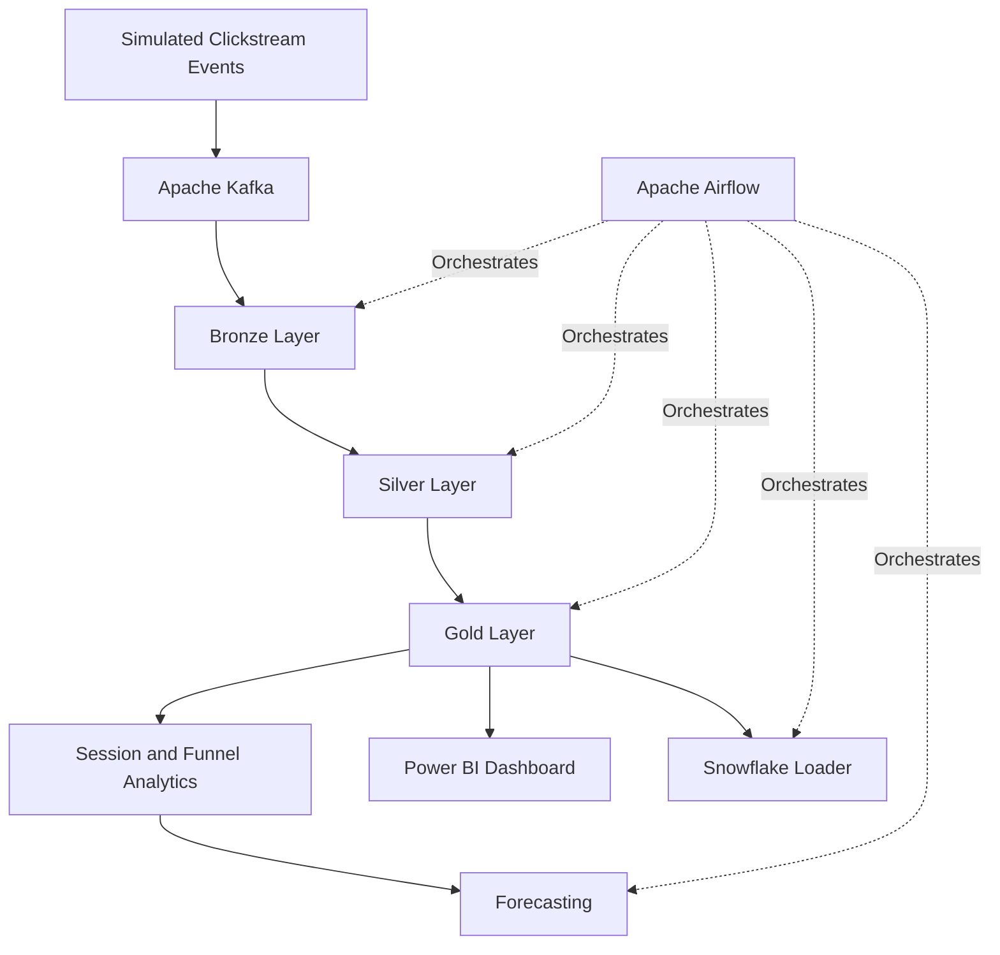

# Clickstream Analytics V2

An end-to-end clickstream analytics project for processing e-commerce user interactions, transforming raw events into analytics-ready datasets, orchestrating data workflows, forecasting trends, and presenting business insights through Power BI.

## Overview

E-commerce platforms generate large volumes of behavioural events, such as page views, product interactions, cart additions, and purchases. Analysing these events helps businesses understand user journeys, measure conversion performance, identify funnel drop-offs, and make data-informed decisions.

**Clickstream Analytics V2** demonstrates a data engineering and analytics workflow built around Kafka, PySpark, a Bronze–Silver–Gold data architecture, Apache Airflow, forecasting, and business intelligence.

The repository also includes data-quality checks, Snowflake integration code, a Flask web application, and automated tests.

## Project goals

- Process simulated clickstream events through a structured data pipeline.
- Separate raw, cleaned, and analytics-ready data using a medallion architecture.
- Analyse sessions and conversion-related behaviour.
- Validate data quality before downstream analytics.
- Orchestrate pipeline stages and demonstrate retry-based task recovery.
- Forecast trends from aggregated data.
- Present business metrics through a Power BI dashboard.

## Architecture



The diagram represents the intended pipeline and orchestration design. The complete workflow should be considered end-to-end validated only after all required services have been configured and the pipeline has run successfully together.

## Technology stack

| Area | Technologies |
|---|---|
| Programming | Python |
| Event ingestion | Apache Kafka |
| Data processing | Apache Spark / PySpark |
| Data architecture | Bronze–Silver–Gold (medallion architecture) |
| Workflow orchestration | Apache Airflow |
| Analytics | SQL, sessionization, conversion and funnel analysis |
| Forecasting | Prophet |
| Experiment and model tracking | MLflow integration |
| Data warehouse integration | Snowflake loader |
| Business intelligence | Power BI |
| Web application | Flask, HTML/CSS and JavaScript assets |
| Testing | pytest |
| Configuration | Environment variables and `.env.example` |

## Pipeline layers

### 1. Event generation and ingestion

The project includes a simulator for generating clickstream events and Kafka-related pipeline components.

The intended flow moves event data from ingestion into the processing pipeline, where the data can be transformed into progressively more useful analytical datasets.

### 2. Bronze layer — raw data

The Bronze layer is the initial landing stage for ingested events.

Its purpose is to preserve the incoming data for downstream processing and provide a foundation for subsequent transformations.

Implementation module: `src/bronze_layer.py`

### 3. Silver layer — cleaned data

The Silver layer prepares data for analysis through cleaning, standardisation, and transformation logic.

Implementation module: `src/silver_layer.py`

### 4. Gold layer — business analytics

The Gold layer produces datasets for analytical use cases. The project includes sessionization and aggregation logic intended to support clickstream and conversion analysis.

Implementation module: `src/gold_layer.py`

### 5. Data quality

The project includes a dedicated module for data-quality checks.

Implementation module: `src/data_quality.py`

Quality validation is designed to help identify problematic data before it is used in downstream analytics.

### 6. Forecasting

The forecasting module contains the project's forecasting logic, using Prophet as part of the intended analytics workflow.

Implementation module: `src/forecasting.py`

Forecast quality depends on the input data, training configuration, and validation results; forecast outputs should not be interpreted as guaranteed business outcomes.

## Workflow orchestration with Airflow

The repository contains two Airflow DAG files:

- `airflow/clickstream_dag_v2.py` — the primary pipeline orchestration DAG.
- `airflow/self_healing_test.py` — a controlled DAG for testing retry-based recovery.

The primary DAG is designed to coordinate pipeline stages such as ingestion, data transformations, quality validation, forecasting, exports, and downstream loading.

The separate recovery test demonstrates how a task can recover through configured retries. This is a controlled retry demonstration, not evidence of a fully automated production incident-management system.

## Business intelligence with Power BI

The repository includes a Power BI dashboard file and a dashboard image asset.

- Dashboard file: `Clickstream_Analytics_Dashboard.pbix`
- Dashboard image: `web/static/powerbi-dashboard.png`

The dashboard is intended to make processed clickstream data easier to explore and communicate to business stakeholders.

Potential business questions include:

- How does user activity change over time?
- Where do users drop out of the conversion funnel?
- How do session and conversion metrics behave across reporting periods?
- What trends should be investigated by product or business teams?

The exact metrics and filters available depend on the report's implemented visuals and connected dataset.

## Snowflake and Databricks integration

The repository contains modules for Snowflake loading and Databricks SQL-related operations:

- `src/snowflake_loader.py`
- `src/databricks_sql.py`

These modules provide integration points for warehouse loading and SQL-based processing.

Actual execution requires the relevant services, credentials, schemas, and configuration. The presence of an integration module alone does not establish that a live warehouse deployment is operational.

## Web application

The repository includes a Flask application and supporting frontend assets:

- `web/app.py`
- `web/templates/`
- `web/static/`

The web application provides a place for the project's web-facing functionality and associated dashboard assets. Refer to the application code and configuration for the exact routes and features currently available.

## Repository structure

```text
clickstream-analytics-v2/
├── airflow/
│   ├── clickstream_dag_v2.py
│   └── self_healing_test.py
├── src/
│   ├── airflow_pipeline.py
│   ├── bronze_layer.py
│   ├── config.py
│   ├── data_quality.py
│   ├── databricks_sql.py
│   ├── forecasting.py
│   ├── gold_layer.py
│   ├── silver_layer.py
│   ├── simulator.py
│   ├── snowflake_loader.py
│   └── spark_utils.py
├── tests/
│   ├── conftest.py
│   ├── test_dag.py
│   ├── test_forecasting.py
│   ├── test_repo_hygiene.py
│   └── test_transformations.py
├── web/
│   ├── app.py
│   ├── static/
│   │   └── powerbi-dashboard.png
│   └── templates/
├── Clickstream_Analytics_Dashboard.pbix
├── .env.example
├── .gitignore
├── README.md
└── requirements.txt
```

This tree highlights the primary implementation directories and known files; it is not intended to list every file in the repository.

## Getting started

### Prerequisites

Prepare the following tools according to the components you intend to run:

- Python 3.12
- Java 17 for the project's PySpark setup
- Apache Kafka for event ingestion
- Apache Airflow for workflow orchestration
- Power BI Desktop to open and inspect the `.pbix` report
- Optional configured Snowflake or Databricks access for the corresponding integrations

Docker may be used where supported by the repository's deployment configuration.

### 1. Clone the repository

```bash
git clone https://github.com/py-kings/clickstream-analytics-v2.git
cd clickstream-analytics-v2
```

### 2. Create a Python environment

Windows PowerShell:

```powershell
py -3.12 -m venv .venv
.\.venv\Scripts\Activate.ps1
```

Install the project dependencies:

```bash
python -m pip install --upgrade pip
pip install -r requirements.txt
```

If a dependency fails to install, check the package's compatibility with your Python version and the requirements pinned by the repository.

### 3. Configure environment variables

Create a local `.env` file using the example configuration as a reference.

```powershell
Copy-Item .env.example .env
```

Populate the variables required by the components you intend to run. Use the names defined in `src/config.py` and `.env.example`.

**Security:** Never commit `.env`, passwords, API tokens, private keys, or production credentials. Keep `.env.example` limited to placeholder values.

### 4. Run the tests

From the repository root:

```bash
python -m pytest tests/ -v
```

Review the test results and resolve failures before treating the corresponding components as verified. Tests that require unavailable services may need the appropriate environment or test configuration.

### 5. Run individual components

Start with the component you want to validate, using its implemented entry point and required configuration:

- Event simulation and Kafka ingestion
- Bronze, Silver, and Gold transformations
- Data-quality validation
- Forecasting
- Airflow orchestration
- Snowflake or Databricks integrations
- Flask application and Power BI report

The exact commands for each component should be taken from its implementation and dependency configuration. A successful test of one component does not automatically verify the full pipeline.

## Testing and validation

The repository includes tests for several areas:

| Test file | Focus indicated by its name |
|---|---|
| `tests/test_dag.py` | Airflow DAG-related checks |
| `tests/test_forecasting.py` | Forecasting logic |
| `tests/test_repo_hygiene.py` | Repository hygiene |
| `tests/test_transformations.py` | Data transformation logic |
| `tests/conftest.py` | Shared pytest fixtures and configuration |

The project has also been worked through in component-level troubleshooting and validation. Before publishing a definitive test count, record a fresh test run and its actual results.

A full integration validation should separately confirm:

1. Events are produced and consumed successfully.
2. Bronze, Silver, and Gold outputs are generated correctly.
3. Quality checks behave as expected.
4. Airflow executes the intended tasks and handles retries.
5. Forecasting produces valid output from the generated data.
6. Warehouse loading succeeds when the relevant credentials and services are configured.
7. The Power BI report can consume and display the intended dataset.

## Current scope and limitations

This repository is a portfolio project demonstrating data engineering and analytics patterns. The level of validation differs by component.

- The project contains pipeline modules, orchestration code, tests, and dashboard assets.
- Retry-based recovery has been demonstrated through a controlled Airflow test.
- The complete multi-service workflow should not be described as production-verified until an end-to-end run has succeeded.
- External integrations depend on correctly configured services and credentials.
- Forecasts and dashboard metrics are only as reliable as their input data and validation.
- The repository does not, by itself, establish production-scale throughput, availability guarantees, or automated incident response.

## Future improvements

Potential next steps include:

- Add a repeatable end-to-end integration test.
- Automate test execution through GitHub Actions.
- Add explicit data-quality reporting and alerting.
- Document service-specific setup commands and configuration.
- Capture a reproducible demo run with sample inputs and outputs.
- Document the Power BI metrics, definitions, and business interpretations.
- Add monitoring for pipeline failures and data freshness.

## Author

**Samadhan Dhake**  
GitHub: [@py-kings](https://github.com/py-kings)

---

*This project is intended to demonstrate practical data engineering, analytics, orchestration, and business intelligence workflows. Feature availability and validation status should be assessed against the current code and deployment environment.*
